# Decido

**A configurable, auditable workflow decision platform for resilient business operations.**

Decido evaluates business requests against YAML-defined workflows, rules, thresholds, branching logic, and dependency policies—without hard-coding decision logic into application code. Every run produces explainable outcomes, rule traces, counterfactual guidance, and a tamper-evident audit trail.

[](https://github.com/logicalavi09/decido/actions/workflows/ci.yml)


## Demo

https://github.com/user-attachments/assets/e0712cc7-9142-4cfc-b88a-e226d4601b05

---

## Overview

Business decision systems must remain correct under changing rules, external failures, duplicate submissions, and operational recovery. Decido addresses this by separating **HTTP/API concerns**, **orchestration**, **pure domain logic**, and **persistence/connectors**.

The same runtime executes multiple domains out of the box—application approvals, claim processing, employee onboarding, vendor approval, and document verification—by swapping configuration, not code.

### Key capabilities

- **Configuration-driven workflows** — YAML-defined stages, rules, transitions, retries, and input schemas with validated reloads.
- **Explainable decisions** — rule-by-rule traces, captured field evidence, reasons, and stage timelines.
- **Counterfactual analysis** — actionable guidance showing what would need to change to alter a deciding outcome.
- **Tamper-evident audit trail** — append-only, SHA-256 hash-chained events with integrity verification.
- **Governance & safety controls** — config linting, dry-run reloads, ETag/concurrency guards, and shadow impact analysis against real inputs.
- **Operational resilience** — idempotent submissions, optimistic locking, transactional writes, dependency retries/failure policies, and resumable runs.
- **Built-in web console** — a build-free, same-origin operations UI for exploring runs, workflows, and change governance.

---

## Architecture at a glance

```text
HTTP API  ->  Orchestration  ->  Pure Domain Logic  ->  Persistence / Connectors
```

| Principle | Benefit |
|---|---|
| Pure domain logic | Deterministic, testable rule evaluation and state transitions with no I/O side effects |
| Config as data | Rule/workflow changes via YAML + validated reload; runs pinned to definition snapshots |
| Transactional boundaries | Stage state and audit events commit together or roll back together |
| Adapter-based integrations | External dependencies isolated behind replaceable connectors |
| Idempotency & optimistic locking | Safe retries, replayed results, and protection against concurrent overwrites |

Detailed design notes: [ARCHITECTURE.md](ARCHITECTURE.md) · [CONFIGURATION.md](CONFIGURATION.md) · [DECISION_EXAMPLES.md](DECISION_EXAMPLES.md)

---

## Quick start

### Prerequisites
- Python **3.11+** (tested on 3.13)

### Install and run

```bash
python3 -m venv .venv
.venv/bin/pip install -r requirements.txt

# Start API + web console (creates data/workflow.db on first run)
.venv/bin/uvicorn app.main:app --reload --port 8000
```

Or with Make:

```bash
make install
make run
```

**Endpoints**
- Web console: [http://localhost:8000](http://localhost:8000)
- OpenAPI docs: [http://localhost:8000/docs](http://localhost:8000/docs)
- Health check: [http://localhost:8000/health](http://localhost:8000/health)

### Run tests

```bash
make test
# or
.venv/bin/python -m pytest

# coverage
make test-cov
```

Current status: **88 tests passing**, ~**89% line coverage** (run `make test-cov` for the latest report).

### Demo script

```bash
./examples/demo.sh
```
(Requires the server to be running.)

---

## Web console

`web/` provides a build-free operations console served directly by FastAPI (vanilla ES modules, self-hosted assets, no separate frontend build/server).

| View | What you can do |
|---|---|
| **Overview** | Monitor decision activity, outcome mix, approval rate, and workflow inventory |
| **Decisions** | Search/filter runs; inspect decision evidence, rule traces, counterfactuals, manual-review actions, and audit streams |
| **Workflows** | Review stages, dependencies, conditions, transitions, snapshot hashes, and lint findings |
| **Change lab** | Lint configs, preview atomic reloads with diff/ETag, and shadow-test candidate changes against real inputs |
| **Demo ledger** | Seed sample approved/review/rejected/failed runs for quick exploration |
| **UX** | Command palette (`Cmd/Ctrl+K`), responsive navigation, toasts, focus states, reduced-motion support |

The console mounts at `/` when `web/` is present; JSON APIs and `/docs` remain available.

---

## API reference (summary)

Base URL: `http://localhost:8000`

| Method | Endpoint | Description |
|---|---|---|
| `GET` | `/health` | Liveness/config/DB status |
| `GET` | `/workflows` | List loaded workflows |
| `GET` | `/workflows/{name}` | Workflow definition, snapshot hash, lint findings |
| `GET` | `/workflows/{name}/lint` | Static configuration analysis |
| `POST` | `/workflows/{name}/impact` | Shadow-evaluate candidate config on historical/supplied inputs |
| `POST` | `/workflows/reload` | Validate and reload YAML (`dry_run`, `If-Match` ETag supported) |
| `POST` | `/runs` | Submit a request (idempotent) |
| `GET` | `/runs` | List runs (`status`, `workflow`, `limit`) |
| `GET` | `/runs/{id}` | Current run state |
| `GET` | `/runs/{id}/audit` | Ordered audit events, snapshot, chain integrity |
| `GET` | `/runs/{id}/audit/verify` | Recompute and verify SHA-256 audit chain |
| `GET` | `/runs/{id}/explanation` | Decision, traces, counterfactuals, reasoning |
| `POST` | `/runs/{id}/resume` | Resume retry-scheduled/running run |
| `POST` | `/runs/{id}/resolve` | Approve/reject manual review |

### Example: submit a request

```bash
curl -s -X POST http://localhost:8000/runs \
  -H 'Content-Type: application/json' \
  -H 'Idempotency-Key: app-2026-0001' \
  -d '{
    "workflow": "application_approval",
    "input": {
      "applicant": {
        "name": "Ada Lovelace",
        "email": "ada@example.com",
        "credit_score": 720,
        "monthly_income": 4000,
        "employment_status": "employed"
      },
      "requested_amount": 15000,
      "country": "US"
    }
  }'
```

- `201 Created` for new submissions
- `200 OK` + `Idempotency-Replayed: true` for replayed requests
- `409` on idempotency key/payload conflict or concurrent modification

### Example: verify audit integrity

```bash
curl -s http://localhost:8000/runs/<run-id>/audit/verify
```

Returns chain validity, algorithm, event count/head hash, and first broken sequence (if any).

> Note: simulation controls (`faults`, `responses`, `latency_ms`, `database_fault`) are supported for demo/testing and excluded from idempotency fingerprints.

---

## Configuration model

Workflows are defined in `workflows/*.yaml`.

**Core concepts**
- **WorkflowConfig** — versioned workflow with input schema, stages, and retry policy
- **StageConfig** — decision step with optional dependency, rules, and transitions
- **Condition** — declarative logic (`all`, `any`, `not`, or leaf comparisons)
- **Rule** — `assert`/`guard` checks with effects (`reject`, `manual_review`, `retry`, `continue`, `branch`)
- **Run / RunEvent** — immutable execution state and append-only audit history

**Included workflows**
1. `application_approval` — thresholding, dependency checks, fast-track branching, manual escalation
2. `claim_processing` — document verification with degraded/manual-review policy
3. `employee_onboarding` — consent, background verification, role-based review
4. `vendor_approval` — tax registry dependency and contract controls
5. `document_verification` — OCR quality thresholds and retry-on-unusable-response

Supported operators include `eq`, `neq`, `gt`, `gte`, `lt`, `lte`, `in`, `contains`, `exists`, `matches`, `between`, length checks, and more. Schema validation supports common JSON-schema-style keywords. Runs store workflow snapshots so in-flight decisions remain reproducible across config changes.

See [CONFIGURATION.md](CONFIGURATION.md) for full reference.

---

## Reliability and consistency

| Concern | Approach |
|---|---|
| Dependency failures/timeouts | Typed adapter failures, bounded retries, configurable failure policies |
| Partial writes | Single-transaction commits for state + audit events |
| Duplicate requests | Idempotency key + payload fingerprint with replay/conflict handling |
| Concurrent updates | Optimistic version checks on run mutations |
| Recovery/retries | Workflow-level retry scheduling, budgets, and manual resume |
| Manual intervention | Explicit manual-review state with audited resolution |
| Audit integrity | SHA-256 hash chain with verification endpoint |

---

## Project structure

```text
app/
  api/            FastAPI routes and request schemas
  core/           Settings, clock, typed errors
  domain/         Models, rule engine, schema validation, state machine, audit/config utilities
  services/       Orchestration, retry scheduler, shadow impact evaluator
  infra/          SQLite repository, config loader, dependency adapters
web/              Build-free operations console (HTML/CSS/ES modules)
workflows/        YAML workflow definitions
tests/            Unit and scenario tests
examples/         Request payloads and demo script
docs/screenshots/ UI snapshots
```

---

## Documentation

- [ARCHITECTURE.md](ARCHITECTURE.md) — design rationale, data flow, trade-offs, scaling considerations
- [CONFIGURATION.md](CONFIGURATION.md) — workflow/rule/schema reference and change management
- [DECISION_EXAMPLES.md](DECISION_EXAMPLES.md) — worked request → rule evaluation → outcome → audit examples

---

## Screenshots

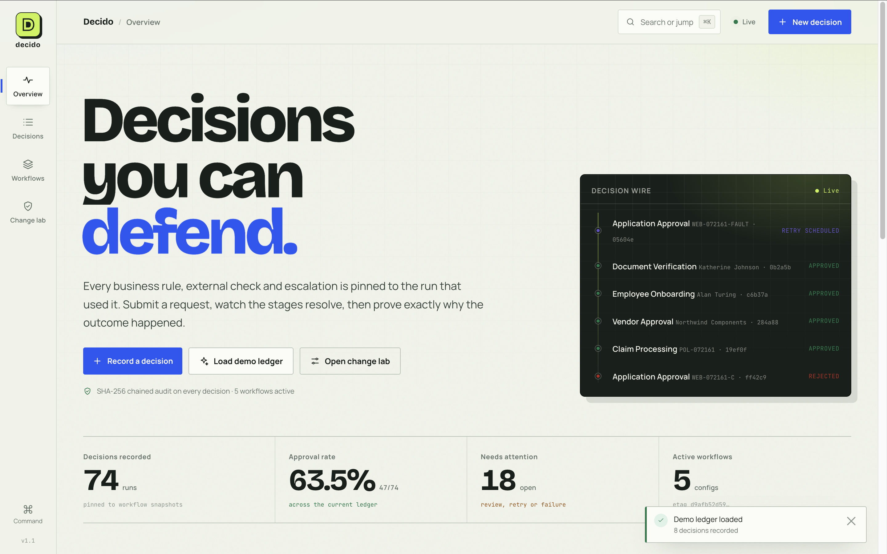

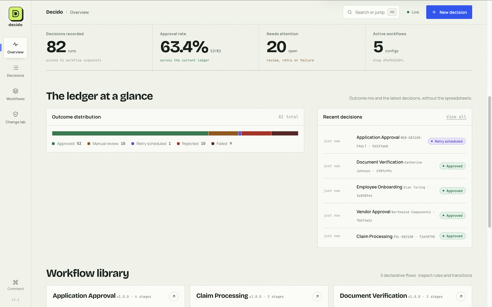

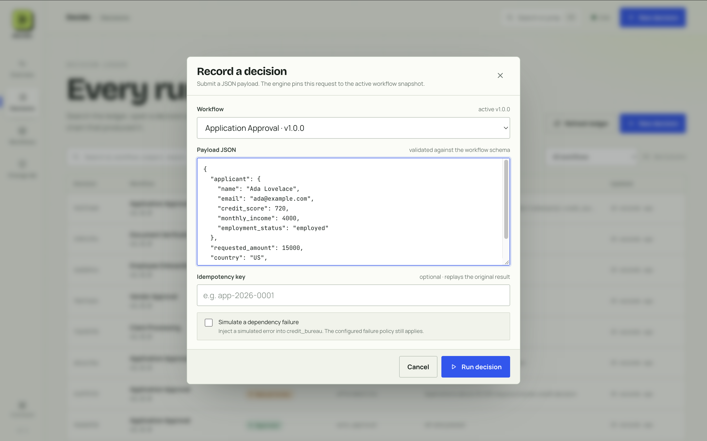

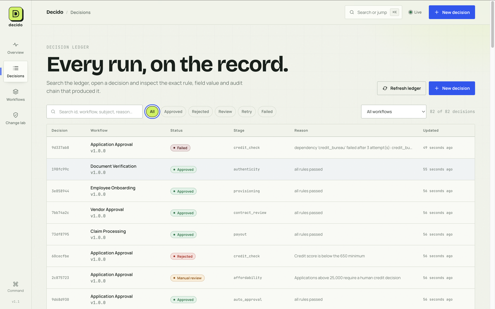

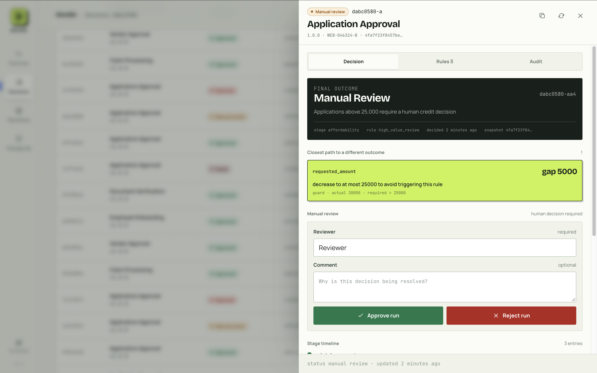

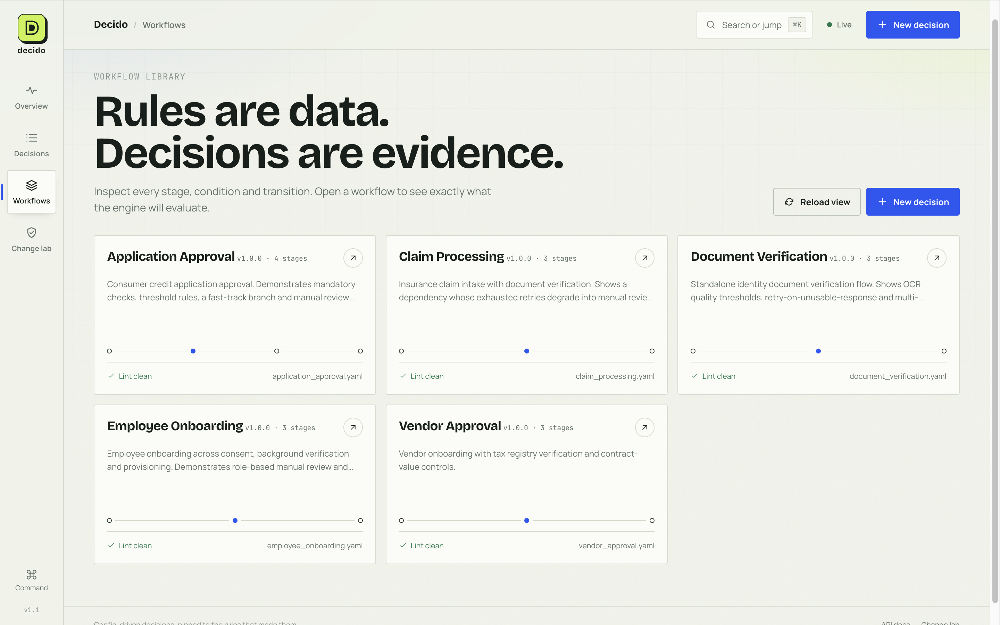

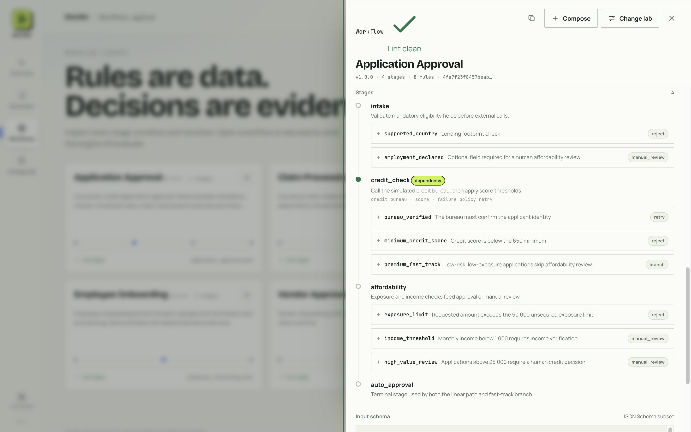

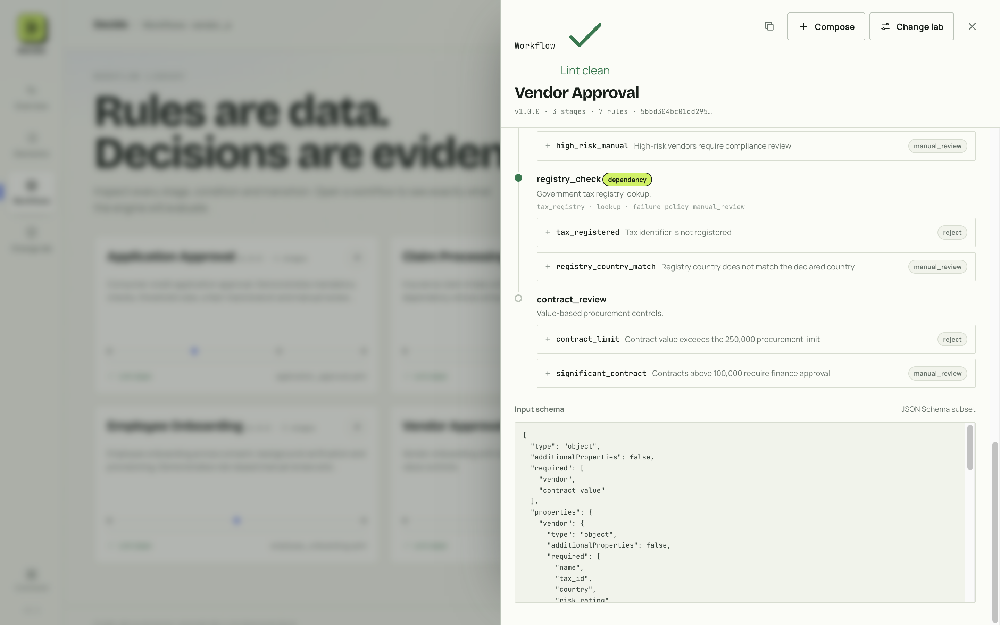

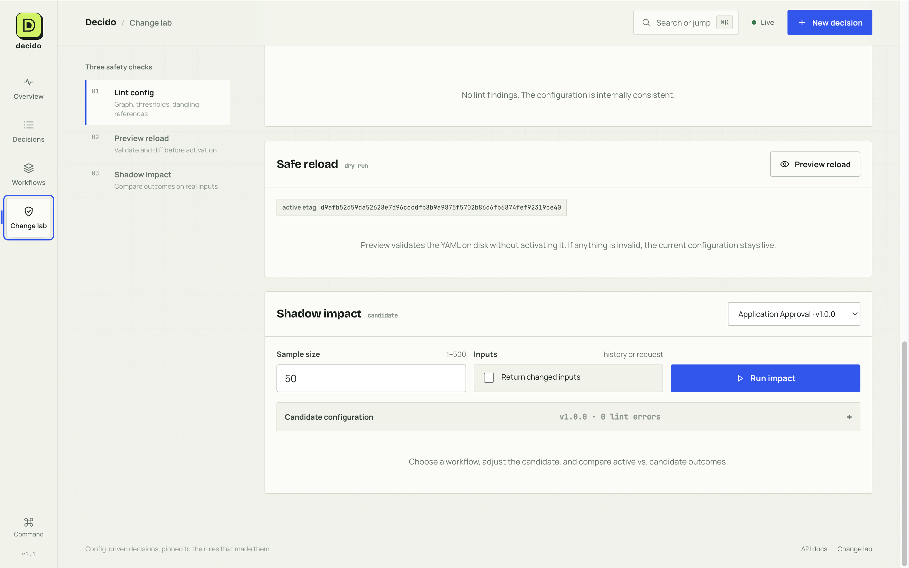

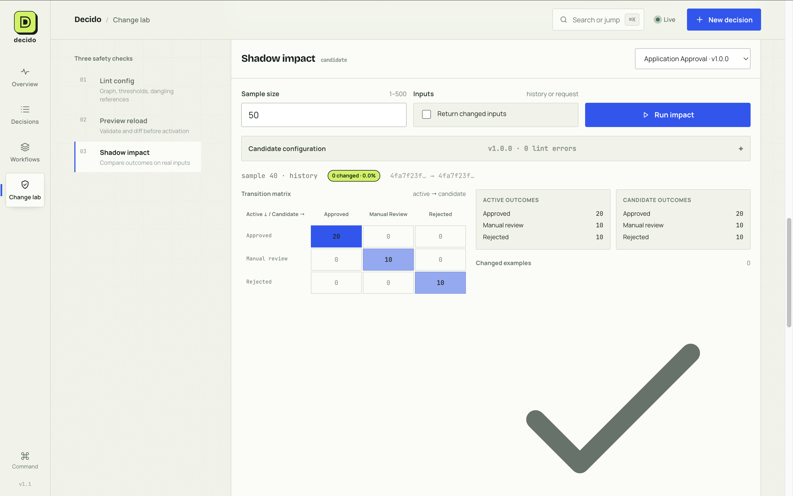

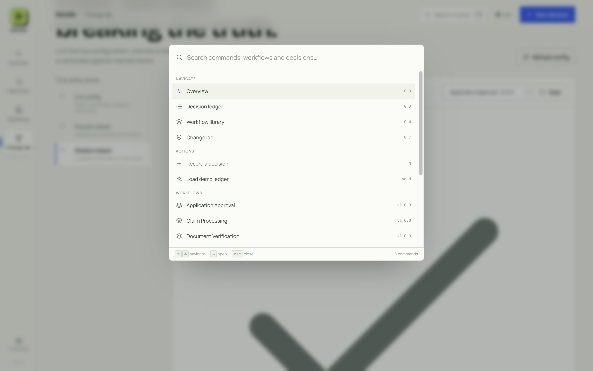

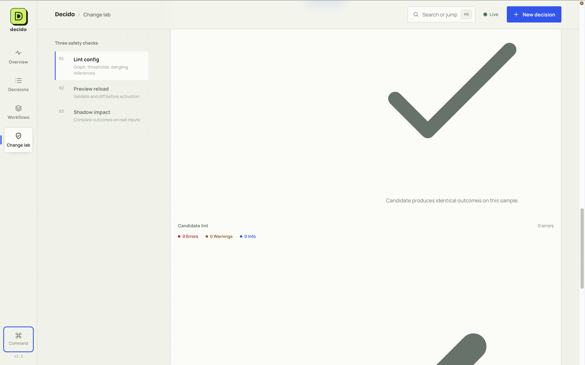

---

## Deployment notes

- A production-ready **Dockerfile** is included (`web/` and workflows bundled; default port `8000`).
- SQLite persistence is suitable for local/demo use; mount/persist the DB path (e.g. `/app/data`) in deployed environments.
- For container platforms requiring dynamic ports, run with: `uvicorn app.main:app --host 0.0.0.0 --port ${PORT:-8000}`.
